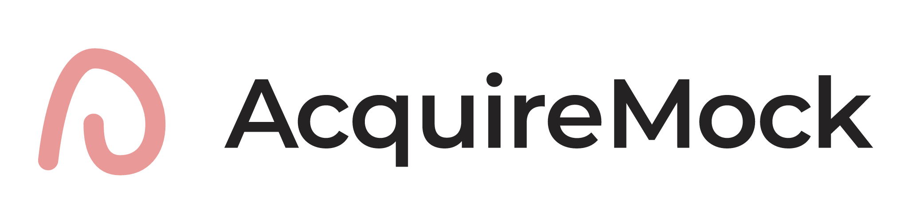
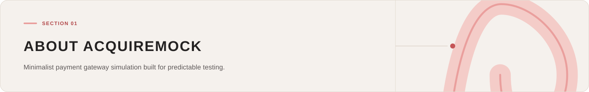
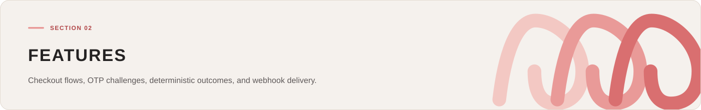
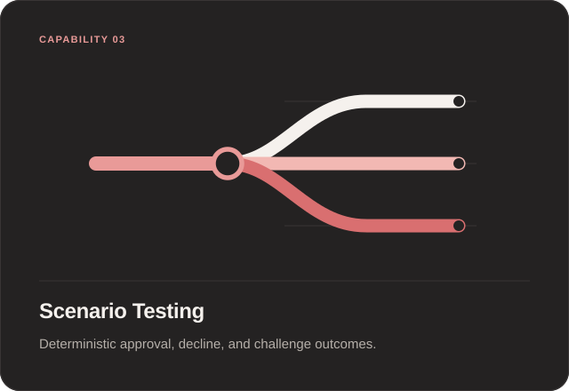
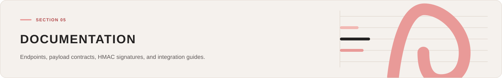

<p align="center">
  
</p>

<p align="center">
  <strong>Self-hosted acquiring &amp; payment gateway simulator for realistic fintech testing.</strong>
</p>

<p align="center">
  <a href="https://github.com/ashfromsky/acquiremock/actions/workflows/tests.yml"></a>
  
  
  
  
</p>

---



AcquireMock is an open-source, self-hosted payment acquiring simulator built with **FastAPI**, **SQLModel**, **Alembic**, and **React**. It lets engineering teams test full checkout flows — invoice creation, card validation, 3DS/OTP verification, idempotency, failure modes, and signed webhook delivery — without connecting to a live processor or card network.

### Why v2.0

- **Admin-protected Developer Console**: Dedicated `/api/admin/*` cookie + CSRF authentication (`ADMIN_USERNAME`, `ADMIN_PASSWORD_HASH`, `SESSION_SECRET`) isolated from customer saved-card sessions.
- **Hardened SSRF Protection**: Resolves all `A`/`AAAA` DNS records per delivery attempt, blocks private/loopback/metadata IPs (unless `ALLOW_LOCAL_WEBHOOKS=true` in development), pins connections to validated IPs, and rejects HTTP redirects.
- **Exact Minor-Unit Money**: Monetary amounts are stored as `BigInteger` minor currency units (for example `25000` USD = `$250.00`) and formatted cleanly for 0-, 2-, and 3-decimal currencies.
- **Persistent Background Worker & Alembic Migrations**: Coordinated `db` -> `migrate` (`alembic upgrade head`) -> `app` + `worker` (`python -m app.worker`) lifecycle with `10s / 20s / 40s / 80s` backoff and DB row locking.

---



| Capability | Summary |
| --- | --- |
| [](#payment-simulation) | **Payment Simulation.** Hosted checkout (`/checkout/{payment_id}`), `EN`/`UK`/`DE`/`RU` localization, Light/Dark themes, `bcrypt` saved cards, and `Strict`/`Lax` CSRF protection. |
| [](#transaction-lifecycle) | **Transaction Lifecycle.** Atomic SQLModel state transitions (`pending`, `waiting_for_otp`, `paid`, `failed`, `expired`), 15-minute auto-expiry, and protected live search at `/app/payments`. |
| [](#scenario-testing) | **Scenario Testing.** Deterministic approval (`4444 4444 4444 4444`), `402 INSUFFICIENT_FUNDS` (`5555 5555 5555 5555`), `410 PAYMENT_EXPIRED`, `Idempotency-Key` conflict protection, and `/app/testing` playground. |
| [](#webhook-delivery) | **Webhook Delivery.** Compact recursively sorted JSON signed with `HMAC-SHA256` (`X-Signature`), `webhook_logs` audit trail (`auto`/`manual`), 5-attempt exponential retry (`10s/20s/40s/80s`), and `/app/webhooks` console. |
| [](#developer-integration) | **Developer Integration.** SQLite or PostgreSQL via async SQLModel + Alembic, non-root Docker images, pinned SSRF protection (`ALLOW_LOCAL_WEBHOOKS=false`), and SlowAPI rate limits. |

---


```text
acquiremock/
├── alembic/                         # Database migrations (0001 initial, 0002 v2 hardening)
├── app/
│   ├── api/routes/                  # FastAPI routers (admin, auth, checkout, console, health, pages, payments, user)
│   ├── core/                        # Config, currency formatting, rate limiter, UTC helpers
│   ├── database/core/               # Async SQLModel engine & session management
│   ├── models/                      # Database tables, request/response schemas, domain errors
│   ├── security/                    # Admin auth, CSRF, bcrypt/HMAC crypto, SSRF pinning, CSP middleware
│   ├── services/                    # Payment creation/processing/lifecycle/idempotency & webhook delivery/retry
│   ├── main.py                      # FastAPI application entrypoint (`app.main:app`)
│   └── worker.py                    # Dedicated background worker (`python -m app.worker`)
├── assets/identity/                 # Official logos, favicons, and README SVG graphics
├── docs/                            # Getting started, API reference, and webhook verification guides
├── examples/                        # FastAPI, Express, and Laravel integration examples
├── frontend/                        # React 19 + TypeScript + Vite Developer Console & Vitest suite
└── tests/                           # Pytest suite (security, SSRF, idempotency, lifecycle, worker, Postgres)
```

---


### Option A: Docker Compose (Recommended)

```bash
git clone https://github.com/ashfromsky/acquiremock.git
cd acquiremock
cp .env.example .env
```

Generate two distinct 32+ character secrets and an administrator bcrypt hash in `.env`:

```bash
python3 -c "import secrets; print('WEBHOOK_SECRET=' + secrets.token_urlsafe(32)); print('SESSION_SECRET=' + secrets.token_urlsafe(32))"
python3 -c "import bcrypt; print('ADMIN_PASSWORD_HASH=\'' + bcrypt.hashpw(b'your-strong-password', bcrypt.gensalt(12)).decode() + '\'')"
```

Start PostgreSQL, run Alembic migrations automatically, and boot `app` + `worker`:

```bash
docker compose up --build -d
```

- Developer Console: `http://localhost:8000/app/login`
- Health Check: `http://localhost:8000/health`

### Option B: Local Development

```bash
git clone https://github.com/ashfromsky/acquiremock.git
cd acquiremock
python3 -m venv .venv
source .venv/bin/activate
pip install -r requirements.txt
cp .env.example .env

cd frontend && npm ci && npm run build && cd ..
.venv/bin/alembic upgrade head
```

Run the API server and dedicated worker in separate terminals (or set `ENABLE_EMBEDDED_WORKER=true` in `.env` for single-process local development):

```bash
.venv/bin/uvicorn app.main:app --reload --host 0.0.0.0 --port 8000
.venv/bin/python -m app.worker
```

---



### Guides & Integration Examples

- [Getting Started Guide](./docs/getting-started.md) — Docker Compose, local setup, secrets, migrations, and test cards
- [API Reference](./docs/api-reference.md) — Invoice, checkout (`/api/pay/{payment_id}`), admin auth (`/api/admin/*`), and console (`/api/console/*`) endpoints + rate limits
- [Webhook Guide](./docs/webhook-guide.md) — Payload schema, `10s / 20s / 40s / 80s` retry backoff, SSRF protections, and recursive `X-Signature` verification in Python, Node.js, PHP, and Ruby
- Integration Examples: [FastAPI](./examples/python/fastapi_integration.py) | [Express](./examples/nodejs/express_integration.js) | [Laravel](./examples/php/laravel_integration.php)

### Required & Key Environment Variables

| Variable | Default | Description |
| --- | --- | --- |
| `WEBHOOK_SECRET` | **Required** | Strong secret (>= 32 chars) for HMAC-SHA256 `X-Signature` signing |
| `SESSION_SECRET` | **Required** | Distinct strong secret (>= 32 chars) for signed admin & customer cookies |
| `ADMIN_USERNAME` | **Required** | Administrator login username for `/app/login` & `/api/console/*` |
| `ADMIN_PASSWORD_HASH` | **Required** | Bcrypt password hash (`$2b$12$...`) for administrator login |
| `DATABASE_URL` | `sqlite+aiosqlite:///./acquiremock.db` | Async database DSN (`sqlite+aiosqlite` or `postgresql+asyncpg`) |
| `ALLOW_LOCAL_WEBHOOKS` | `false` | Keep `false` in production; enable only for localhost webhook dev testing |
| `ENABLE_EMBEDDED_WORKER` | `false` | Run dedicated worker (`python -m app.worker`) in production |
| `CURRENCY_CODE` / `CURRENCY_SYMBOL` | `USD` / `$` | Currency display & decimal precision (0, 2, or 3 decimals) |
| `PAYMENT_TTL_MINUTES` | `15` | Invoice expiration timeout in minutes |
| `WEBHOOK_MAX_ATTEMPTS` | `5` | Maximum webhook delivery attempts (1 initial + 4 retries) |
| `WEBHOOK_TIMEOUT_SECONDS` | `10` | Per-request outgoing webhook HTTP timeout |

### Running Tests

```bash
# Backend
TESTING=true \
DATABASE_URL=sqlite+aiosqlite:///:memory: \
WEBHOOK_SECRET=test-webhook-secret-key-at-least-32-characters \
SESSION_SECRET=test-session-secret-key-at-least-32-characters \
ADMIN_USERNAME=admin \
ADMIN_PASSWORD_HASH='$2b$12$i/bda5DB0i74vSubiIswMe6rBh9Ft4wVxieTuJbTo.PgMYHvzovC.' \
.venv/bin/pytest -v

# Frontend
cd frontend && npm run typecheck && npm test && npm run build
```

---


Contributions are welcome! Please read [CONTRIBUTING.md](./CONTRIBUTING.md) before opening a pull request.

- [GitHub Issues](https://github.com/ashfromsky/acquiremock/issues)
- [GitHub Discussions](https://github.com/ashfromsky/acquiremock/discussions)
