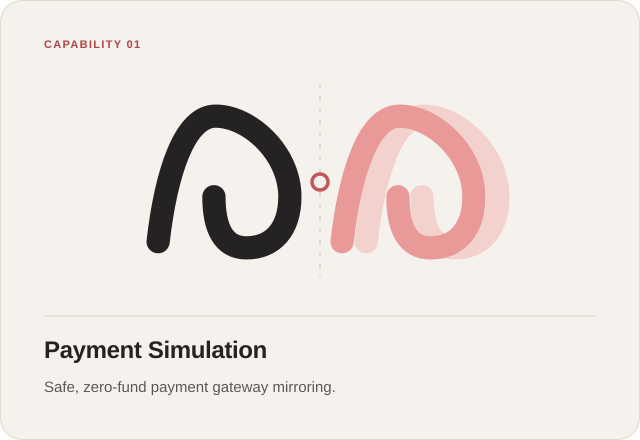
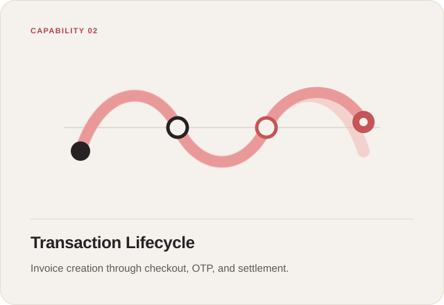
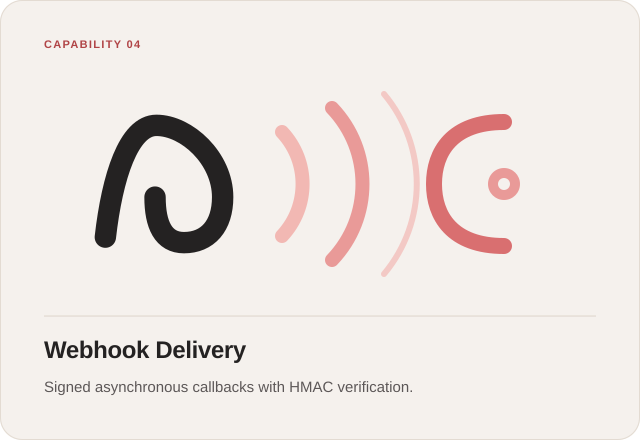
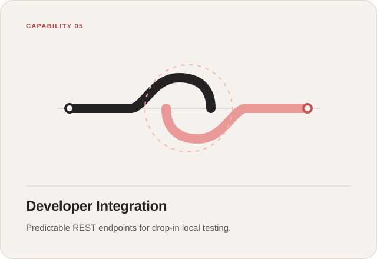
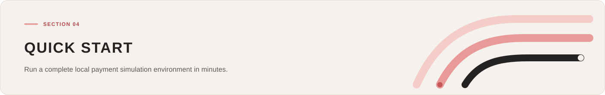
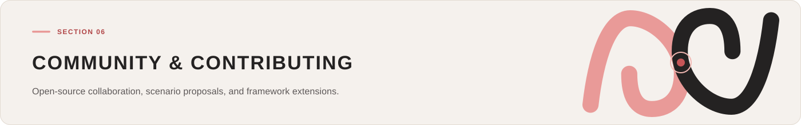

<div align="center">

<br />

<picture>
  <source media="(prefers-color-scheme: dark)" srcset="app/static/brand/logo-horizontal-dark.png" />
  
</picture>

<br /><br />

<p><strong>Self-hosted mock payment gateway for testing payment integrations end to end.</strong></p>

<p>Simulate invoice creation, hosted card checkout, email OTP verification, saved cards, and HMAC-SHA256 webhooks on your local machine or staging environment without external PSP credentials or real money.</p>

<p>
  <a href="https://www.python.org/downloads/"></a>
  <a href="https://fastapi.tiangolo.com"></a>
  <a href="https://react.dev"></a>
  
  <a href="LICENSE"></a>
</p>

<p>
  <a href="#about">About</a> &middot;
  <a href="#features">Features</a> &middot;
  <a href="#architecture">Architecture</a> &middot;
  <a href="#quick-start">Quick Start</a> &middot;
  <a href="#documentation">Documentation</a> &middot;
  <a href="#contributing">Contributing</a>
</p>

</div>

---

<a name="about"></a>

<p align="center">
  
</p>

AcquireMock lets your application test real HTTP payment flows locally without hitting production acquirers or sharing sandbox keys across developer machines. Your backend creates an invoice with one POST request, redirects buyers to a server-rendered checkout page, completes a 4-digit email OTP challenge, and receives HMAC-signed webhook callbacks.

### What Ships Out of the Box

| Surface | Path | Description |
| :--- | :--- | :--- |
| **Editorial Homepage & Console** | `/`, `/app/overview` | React + TypeScript workspace with live gateway metrics, payment history, and configuration status. |
| **Payment Testing Playground** | `/app/testing`, `/test` | Interactive invoice builder with live JSON/cURL previews and session link history. |
| **Hosted Checkout & OTP** | `/checkout/{payment_id}`, `/otp/{payment_id}` | Server-rendered Jinja2 checkout, 4-digit OTP confirmation, saved cards, and `EN`/`UK`/`DE`/`RU` UI with dark mode. |
| **Webhook Inspector & Verifier** | `/app/webhooks`, `/webhooks/verify` | Delivery log viewer, manual retry trigger, and `X-Signature` HMAC verification tool. |
| **OpenAPI Specification** | `/docs`, `/redoc`, `/openapi.json` | Interactive Swagger UI and ReDoc documentation generated directly from FastAPI schemas. |

> [!WARNING]
> **Testing and development use only.** Never enter real payment card numbers, store real cardholder data, or deploy AcquireMock as a live financial processor.

---

<a name="features"></a>

<p align="center">
  
</p>

<p align="center">
  <a href="#payment-simulation"></a>
  <a href="#transaction-lifecycle"></a>
</p>

<p align="center">
  <a href="#scenario-testing"></a>
</p>

<p align="center">
  <a href="#webhook-delivery"></a>
  <a href="#developer-integration"></a>
</p>

### Payment Simulation

Customers pay on a hosted checkout page protected by a double-submit `Strict` CSRF cookie and hidden form token. Returning payers can authenticate via email OTP to save sandbox cards (hashed with `bcrypt`) and reuse them through an HMAC-signed `HttpOnly` session cookie (`user_session`, 30-day lifetime). Checkout pages support English, Ukrainian, German, and Russian translations along with Warm Light and Charcoal Dark themes.

### Transaction Lifecycle

Every invoice moves through explicit states tracked in SQLModel: `pending`, `waiting_for_otp`, `paid`, `failed`, and `expired` (with `refunded` defined in `PaymentStatus`). Invoices expire automatically 15 minutes after creation, enforced both on request access and by a background sweep running every 60 seconds. The developer workspace at `/app/payments` lets you search by order reference or payment ID and inspect full state timelines.

### Scenario Testing

Use deterministic inputs to exercise approval, decline, expiry, and retry paths in automated tests or the `/app/testing` playground:

| Input / Condition | HTTP / State Outcome | Notes |
| :--- | :--- | :--- |
| Card `4444 4444 4444 4444` (any future `MM/YY`, any 3-digit CVV) | `waiting_for_otp` -> `paid` | Sends a 4-digit OTP (or settles immediately if `user_session` already matches `email`). |
| Any other card number | `402` `INSUFFICIENT_FUNDS` (`failed`) | Records failure code and message on the payment record. |
| Checkout or OTP submitted after 15 minutes | `410` `PAYMENT_EXPIRED` (`expired`) | Enforced both inline and by the background expiration task. |
| Repeated `POST /api/pay/{payment_id}` with `Idempotency-Key` | Replays original outcome | Prevents duplicate payment processing on client retries. |
| Missing or mismatched CSRF token | `403` `CSRF_TOKEN_MISMATCH` | Verified in constant time with `hmac.compare_digest`. |

### Webhook Delivery

Upon settlement, AcquireMock sends a POST request to your `webhookUrl` containing compact sorted JSON signed with `HMAC-SHA256` in the `X-Signature` header (`X-Payment-ID` is also included). Each attempt is persisted in `webhook_logs`. Failed deliveries are retried automatically in the background (up to 5 attempts, with `2^attempt` second backoff on the retry loop running every 300 seconds) and can be retriggered manually from `/app/webhooks` or `/app/payments/{payment_id}`.

### Developer Integration

AcquireMock runs on SQLite (`sqlite+aiosqlite`) or PostgreSQL (`postgresql+asyncpg`) and logs OTP codes to stdout when SMTP credentials are omitted:

- Redirect and webhook URLs reject non-HTTP(S) schemes, cloud metadata hosts, and private or loopback IP addresses unless `ALLOW_LOCAL_WEBHOOKS=true` is configured.
- `SecurityHeadersMiddleware` applies `X-Frame-Options: DENY`, `X-Content-Type-Options: nosniff`, and `X-XSS-Protection`, while SlowAPI enforces per-IP rate limits across invoice, payment, OTP, auth, and webhook retry endpoints.

---

<a name="architecture"></a>

<p align="center">
  
</p>

### Repository Structure

```text
acquiremock/
├── app/
│   ├── main.py                      # FastAPI v2.0.0 entrypoint, middleware, SPA asset mount
│   ├── api/routes/                  # payments, checkout, pages, auth, console, webhooks, user, health
│   ├── core/                        # Environment config & SlowAPI rate limiter
│   ├── database/core/               # Async SQLAlchemy engine and session management
│   ├── functional/                  # Payment, saved card, and webhook CRUD helpers
│   ├── models/                      # SQLModel entities, Pydantic invoice schemas, error classes
│   ├── security/                    # HMAC signing, bcrypt hashing, CSRF, SSRF & XSS sanitization
│   ├── services/                    # Webhook dispatcher, SMTP/console OTP service, background loops
│   └── static/                      # Brand assets, shared CSS tokens, checkout styles, i18n
├── frontend/                        # React 19 + TypeScript + Vite 6 developer console & homepage
├── templates/                       # Jinja2 checkout, OTP, success, error, and email templates
├── docs/                            # Getting started, API reference, and webhook integration guides
├── examples/                        # FastAPI (Python), Express.js (Node), and Laravel (PHP) samples
├── tests/                           # Pytest async API, checkout, security, webhook, and console suites
├── assets/identity/                 # Official logos, favicons, and README SVG graphics
├── Dockerfile                       # Multi-stage Node 22 + Python 3.12 container build
└── docker-compose.yml               # App + PostgreSQL 15 service definition
```

### Database Schema

| Table | Purpose | Key Columns |
| :--- | :--- | :--- |
| `payments` | Tracks invoice lifecycle and webhook delivery state | `id` (PK), `amount`, `reference`, `status`, `card_mask`, `idempotency_key`, `webhook_url`, `redirect_url`, `webhook_attempts`, `webhook_status`, `expires_at`, `paid_at` |
| `saved_cards` | Stores returning payer cards hashed with `bcrypt` | `id` (PK), `email`, `card_token`, `card_hash`, `expiry`, `card_mask`, `psp_provider` |
| `successful_operations` | Records settled receipts per buyer email | `id` (PK), `payment_id` (unique), `email`, `amount`, `reference`, `card_mask`, `redirect_url` |
| `webhook_logs` | Audits every outbound webhook attempt and response | `id` (PK), `payment_id`, `webhook_url`, `payload`, `response_status`, `response_body`, `signature`, `attempt_number`, `success`, `error_message` |

---

<a name="quick-start"></a>

<p align="center">
  
</p>

### Prerequisites

- **Docker path:** Docker and Docker Compose.
- **Manual path:** Python 3.11+ (with SQLite for local dev or PostgreSQL 12+), plus Node.js 20+ only if building the React console bundle locally.

### Option 1: Docker Compose (Recommended)

The multi-stage [Dockerfile](Dockerfile) compiles the React console and serves both the API and UI behind Gunicorn + Uvicorn workers alongside PostgreSQL 15:

```bash
git clone https://github.com/illusiOxd/acquiremock.git
cd acquiremock
docker-compose up --build
```

Once running, open:

- Homepage and interactive lifecycle stage: `http://localhost:8000`
- Developer Console: `http://localhost:8000/app/overview`
- Payment Testing Playground: `http://localhost:8000/app/testing`
- OpenAPI Swagger UI: `http://localhost:8000/docs`
- Health Check: `http://localhost:8000/health`

Or use the included [Makefile](Makefile) shortcut: `make quick-start`.

### Option 2: Local Setup

```bash
git clone https://github.com/illusiOxd/acquiremock.git
cd acquiremock

python3 -m venv .venv
source .venv/bin/activate
pip install -r requirements.txt

cp .env.example .env
```

Before starting locally without PostgreSQL, edit `.env` to use SQLite and set a 32+ character `WEBHOOK_SECRET`:

```env
DATABASE_URL=sqlite+aiosqlite:///./payment.db
WEBHOOK_SECRET=replace_with_a_random_32_plus_char_secret
BASE_URL=http://localhost:8000
ALLOW_LOCAL_WEBHOOKS=true
```

Optional: build the React frontend bundle (`frontend/dist`) so FastAPI serves the full developer console (without it, FastAPI falls back to Jinja2 pages in `templates/pages/`):

```bash
cd frontend && npm ci && npm run build && cd ..
```

Start the FastAPI server:

```bash
uvicorn app.main:app --port 8000 --reload
```

### Environment Variables

| Variable | Required | Default | Description |
| :--- | :--- | :--- | :--- |
| `DATABASE_URL` | Yes | None | Async SQLAlchemy URI (`postgresql+asyncpg://...` or `sqlite+aiosqlite:///./payment.db`). |
| `WEBHOOK_SECRET` | Yes | None | Secret key used for HMAC-SHA256 webhook signatures and `user_session` cookies. |
| `BASE_URL` | No | `http://localhost:8000` | Public base URL used when building `pageUrl` and setting `Secure` cookies on `https://`. |
| `CURRENCY_CODE` | No | `USD` | ISO 4217 currency code returned by `/health` and `/api/console/config`. |
| `CURRENCY_SYMBOL` | No | `$` | Currency symbol rendered in checkout and developer console views. |
| `ALLOW_LOCAL_WEBHOOKS` | No | `false` | Set `true` in `.env` when delivering webhooks to `localhost` or private network targets. |
| `SMTP_HOST`, `SMTP_PORT`, `SMTP_USER`, `SMTP_PASS` | No | Unset | Optional SMTP credentials for OTP and receipt emails; logs OTP codes to stdout when unset. |

### Running Tests

Disable background loops with `TESTING=true` when running the test suite:

```bash
TESTING=true DATABASE_URL=sqlite+aiosqlite:///:memory: WEBHOOK_SECRET=dev_test_secret_key_at_least_32_chars pytest -v
```

---

<a name="documentation"></a>

<p align="center">
  
</p>

### Core Endpoints

| Method & Path | Rate Limit | Purpose |
| :--- | :--- | :--- |
| `POST /api/create-invoice` | `30/min` | Create an invoice (`amount`, `reference`, `webhookUrl`, `redirectUrl`) and receive `pageUrl`. |
| `GET /checkout/{payment_id}` | Default | Render hosted checkout form and issue `csrf_token` cookie. |
| `POST /api/pay/{payment_id}` | `5/min` | Process card or saved card submission (supports `Idempotency-Key` header). |
| `GET /otp/{payment_id}`, `POST /otp/verify/{payment_id}` | `5/min` (verify) | Render and verify 4-digit OTP challenge; `POST /otp/resend/{payment_id}` is capped at `3/min`. |
| `GET /success/{payment_id}` | Default | Display payment receipt and link back to `redirectUrl`. |
| `POST /webhooks/verify` | Default | Validate an `X-Signature` digest against a JSON payload using the server `WEBHOOK_SECRET`. |
| `GET /api/console/overview`, `GET /api/console/payments`, `GET /api/console/webhooks` | Default | Power the developer console metrics, filters, and delivery history. |
| `POST /api/console/webhooks/{payment_id}/retry` | `10/min` | Trigger an immediate webhook delivery retry for a payment. |
| `GET /health` | Default | Return service status, timestamp, version (`2.0.0`), and configured currency. |

### Create an Invoice

```bash
curl -X POST http://localhost:8000/api/create-invoice \
  -H "Content-Type: application/json" \
  -d '{
    "amount": 25000,
    "reference": "ORDER-1042",
    "webhookUrl": "https://your-site.com/webhook",
    "redirectUrl": "https://your-site.com/success"
  }'
```

**Response (`200 OK`):**

```json
{
  "pageUrl": "http://localhost:8000/checkout/550e8400-e29b-41d4-a716-446655440000"
}
```

### Verify Incoming Webhooks

AcquireMock delivers webhook events with `Content-Type: application/json`, `X-Payment-ID`, and `X-Signature` headers:

```json
{
  "payment_id": "550e8400-e29b-41d4-a716-446655440000",
  "reference": "ORDER-1042",
  "amount": 25000,
  "status": "paid",
  "timestamp": "2026-11-27T12:14:00.000000",
  "card_mask": "**** 4444"
}
```

Serialize the parsed JSON object with **sorted keys and compact separators** (no spaces after `:` or `,`), then compare the hex HMAC-SHA256 digest in constant time:

```python
import hashlib
import hmac
import json

def verify_acquiremock_signature(payload: dict, signature: str, secret: str) -> bool:
    message = json.dumps(payload, sort_keys=True, separators=(",", ":"))
    expected = hmac.new(secret.encode(), message.encode(), hashlib.sha256).hexdigest()
    return hmac.compare_digest(expected, signature)
```

```javascript
import crypto from "node:crypto";

export function verifyAcquireMockSignature(payload, signature, secret) {
  const sorted = Object.keys(payload).sort().reduce((acc, key) => {
    acc[key] = payload[key];
    return acc;
  }, {});
  const message = JSON.stringify(sorted);
  const expected = crypto.createHmac("sha256", secret).update(message).digest("hex");
  const sigBuf = Buffer.from(signature);
  const expBuf = Buffer.from(expected);
  return sigBuf.length === expBuf.length && crypto.timingSafeEqual(sigBuf, expBuf);
}
```

### Guides & Integration Examples

| Resource | Path |
| :--- | :--- |
| Getting Started Guide | [docs/getting-started.md](docs/getting-started.md) |
| Full API Reference | [docs/api-reference.md](docs/api-reference.md) |
| Webhook Integration Guide | [docs/webhook-guide.md](docs/webhook-guide.md) |
| FastAPI Integration Example | [examples/python/fastapi_integration.py](examples/python/fastapi_integration.py) |
| Express.js Integration Example | [examples/nodejs/express_integration.js](examples/nodejs/express_integration.js) |
| Laravel Integration Example | [examples/php/laravel_integration.php](examples/php/laravel_integration.php) |

---

<a name="contributing"></a>

<p align="center">
  
</p>

### How to Contribute

Contributions, bug reports, and new framework integration examples are welcome. Review [CONTRIBUTING.md](CONTRIBUTING.md) before opening a pull request.

1. Fork the repository and create a branch from `development`.
2. Make focused changes and add or update tests under `tests/`.
3. Verify checks locally before pushing:

```bash
TESTING=true DATABASE_URL=sqlite+aiosqlite:///:memory: WEBHOOK_SECRET=dev_test_secret_key_at_least_32_chars pytest -v
make lint
make frontend-build
```

- [GitHub Issues](https://github.com/illusiOxd/acquiremock/issues)
- [GitHub Discussions](https://github.com/illusiOxd/acquiremock/discussions)

### License

AcquireMock is licensed under the **Apache License 2.0**. See [LICENSE](LICENSE) for the full text.

---

<div align="center">
  <sub>AcquireMock v2.0.0 &middot; Built with FastAPI, SQLModel, Jinja2, and React</sub>
</div>
